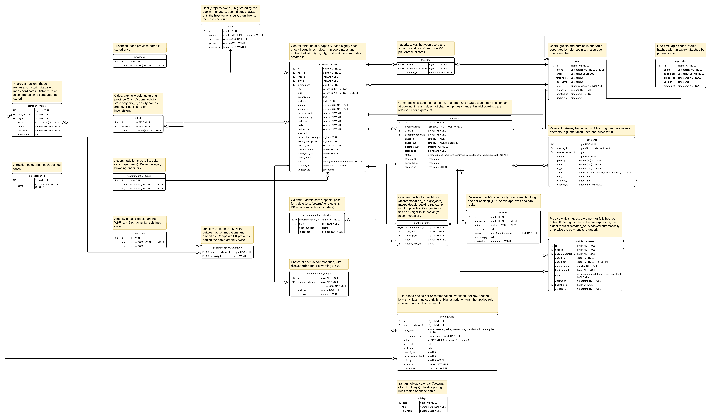

# Booking Platform: ERD + Backend

پروژهٔ بوت‌کمپ: سامانهٔ رزرو اقامتگاه (مشابه جاباما) در دو مرحله.

## مرحلهٔ ۱: طراحی دیتابیس (ERD)
۲۱ جدول و ۸ Enum برای PostgreSQL.
- منبع نمودار: [`booking-erd.dbml`](booking-erd.dbml) و اسکیمای اجرایی [`booking-erd.sql`](booking-erd.sql)
- توضیح تصمیم‌های طراحی: [`ERD-explanation.md`](ERD-explanation.md)
- نمودار: [`booking-erd.png`](booking-erd.png) و [نسخهٔ Lucidchart](https://lucid.app/lucidchart/364204e7-4e9d-47c8-b821-4c1305d35587/edit?invitationId=inv_fee3c583-3e1b-4c69-b19a-a37b14c9b60e)

## مرحلهٔ ۲: بک‌اند
FastAPI، SQLAlchemy 2 و PostgreSQL 16، با مستندات Swagger و تست end-to-end.
- اجرا با یک دستور: `cd backend && docker compose up --build`، بعد http://localhost:8000/docs
- راهنمای کامل و فهرست اندپوینت‌ها: [`backend/README.md`](backend/README.md)
- کالکشن Postman: [`backend/postman_collection.json`](backend/postman_collection.json)

**نکته‌های برجسته**
- جلوگیری از رزرو تکراری در سطح دیتابیس: کلید اصلی `booking_nights` روی (اقامتگاه، شب). در تست با ۵ درخواست هم‌زمان فقط یکی موفق می‌شود.
- قیمت‌گذاری قاعده‌مند: آخر هفته، تعطیلات رسمی ایران، فصل، اقامت طولانی، لحظهٔ آخری و رزرو زودهنگام.
- صف انتظار با پیش‌پرداخت که بعد از لغو یک رزرو، خودکار رزرو می‌کند.
- جاذبه‌های اطراف به ترتیب فاصله، که از مختصات در خود دیتابیس حساب می‌شود.

## مرحلهٔ ۳: فرانت‌اند «دور ایران»

**نسخهٔ آنلاین:** https://dor-iran.vercel.app (بک‌اند: https://dor-iran-api.vercel.app/docs، دیتابیس Neon Postgres)

Next.js، Tailwind CSS و shadcn/ui، فارسی و راست‌به‌چپ، وصل به همین بک‌اند. تیتر: «ایران؛ دورت بگردم».
- اجرا: `cd frontend && npm install && npm run dev`، بعد http://localhost:3000
- راهنما و فهرست صفحه‌ها: [`frontend/README.md`](frontend/README.md)؛ سناریوی ویدئوی دمو: [`frontend/demo-script.md`](frontend/demo-script.md)
- **بالای صفحهٔ اول:** دستهٔ کارت‌پستال سه‌بعدی با رنگ و صدای هر مکان، بازسازی‌شده از رفتار سایت Netflix Voyage en France با مهندسی معکوس (REA)
- **از یک جاذبه شروع کن:** پیدا کردن اقامتگاه بر اساس نزدیکی به جاذبه‌های طبیعی و گردشگری
- **قطب‌نمای کشف:** جاذبه‌های اطراف هر اقامتگاه با جهت و فاصلهٔ واقعی
- **کارت‌پستال با صدای همان‌جا** و **گذرنامهٔ سفر** با مهر هر شهری که مسافر رفته
- رزرو با تقویم شمسی و قیمت شب‌به‌شب، پرداخت آزمایشی، صف انتظار، نظر، علاقه‌مندی و پنل مدیریت کامل

